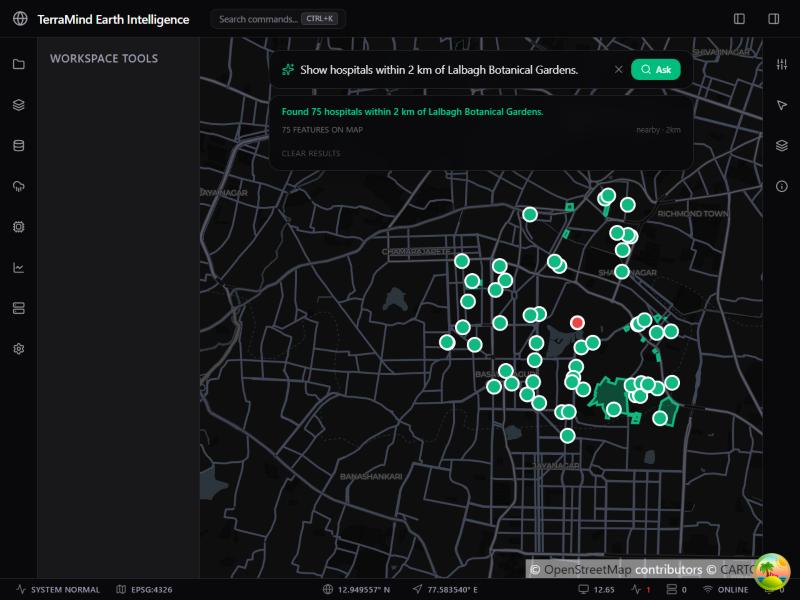

# TerraMind AI

[](https://github.com/ronitsaha11/TerramindAI/actions/workflows/ci.yml)


**An Earth Intelligence platform that turns natural-language questions into
verifiable geospatial analysis.** Ask *"Show hospitals within 2 km of Lalbagh
Botanical Gardens"* and TerraMind answers with real features from your own
datasets, computed by PostGIS and drawn on an interactive map.



## Why

Spatial questions are easy to say and tedious to answer: find the dataset,
locate the reference place, pick the right predicate, get the units right,
then render the result. Language models can read the question, but an answer
invented by a model is not an answer anyone can rely on.

TerraMind keeps those two jobs apart. The model only **interprets** the
question into a small, strictly validated structure. Every result is then
**computed** by deterministic PostGIS queries over data you control, so it can
be reproduced and checked.

## How a question is answered

```
"Show hospitals within 2 km of Lalbagh Botanical Gardens"
        │
        ▼
 NLQ panel (React) ── POST /api/v1/projects/{id}/query/natural ──► FastAPI
                                                                     │
        Gemini interprets the question into a SpatialIntent ◄────────┤
        (closed schema: nearby | contains | intersects, ≤ 50 km)     │
                                                                     ▼
                      Dataset, category and reference place resolved
                      against the project's own catalogue
                                                                     │
                      Deterministic spatial engine ─► PostGIS        │
                      (ST_DWithin / ST_Contains / ST_Intersects)     │
                                                                     ▼
                      GeoJSON FeatureCollection ─► MapLibre GL renders it
```

The model never writes SQL and never sees the database. If a place name is
ambiguous ("Lalbagh" matches a station, a nursing home and the botanical
gardens) or a category does not exist in the project, TerraMind asks or
explains instead of guessing, and no spatial query is run.

## Features

- **Natural-language spatial queries.** Nearby, contains and intersects
  questions, interpreted by Google Gemini and validated against a closed
  Pydantic schema before anything executes. Ambiguous places return
  candidates; unknown categories are reported, not approximated.
- **PostGIS spatial engine.** Features are stored as real geometries with a
  GiST index. Distances use `::geography`, so radii are measured in metres on
  the WGS-84 ellipsoid.
- **Interactive map.** MapLibre GL with a dataset registry, layer management
  and colour-coded query results.
- **GeoJSON import.** Datasets uploaded as GeoJSON become queryable
  immediately.
- **Raster analytics.** NDVI, NDWI and NDBI spectral indices over raster
  scenes, computed by the backend's analytics engine.
- **Background jobs.** Long-running work runs on Celery with Redis.
- **API-key failover.** Several Gemini keys can be configured; a request
  refused for quota moves to the next key. This is failover, not extra quota.

## Architecture

| Layer | Location | Technology |
| --- | --- | --- |
| Frontend | `frontend/` | React 19, TypeScript, Vite, MapLibre GL 6, Zustand, TanStack Query, Tailwind CSS |
| API | `apps/backend/` | FastAPI, Pydantic v2, SQLAlchemy 2 (async), GeoAlchemy2 |
| Language interpretation | `apps/backend/src/nlq/` | Google Gemini via `google-genai` |
| Database | Docker | PostgreSQL + PostGIS 15-3.3 |
| Jobs | `apps/backend/` | Celery + Redis |
| Raster / ML | `apps/backend/src/analytics/`, `apps/backend/src/ai/` | rasterio, PyTorch, Transformers (SegFormer, backend only) |

> `apps/frontend/` is a dead Next.js scaffold kept only for history. The active
> frontend is the root-level `frontend/` directory. Do not build there.

## Getting started

### Prerequisites

- Node.js 22 and **pnpm** (not npm)
- Python 3.13
- Docker Desktop

### Configure

```bash
cp .env.example .env
cp apps/backend/.env.example apps/backend/.env
cp frontend/.env.example frontend/.env
```

Natural-language queries need at least one Gemini API key in
`apps/backend/.env`:

```bash
GEMINI_API_KEY_1=...
# Optional extra keys for failover:
# GEMINI_API_KEY_2=...
# NLQ_MODEL=gemini-3.6-flash
```

Keys stay on the server. Without a key everything else works and
`/query/natural` returns `503`. Never put a key in `frontend/.env`: every
`VITE_` variable is shipped to the browser.

### Run (Windows)

From the repository root:

```powershell
powershell -ExecutionPolicy Bypass -File scripts\start_stack.ps1
```

This starts PostgreSQL and Redis in Docker, applies migrations, then launches
the Celery worker, the API and the Vite dev server natively, verifying each
layer before continuing.

| Service  | URL |
| -------- | --- |
| Frontend | http://localhost:5273 |
| API docs (OpenAPI) | http://127.0.0.1:8000/docs |
| Health   | http://127.0.0.1:8000/api/v1/health |

To stop:

```powershell
powershell -ExecutionPolicy Bypass -File scripts\stop_stack.ps1
```

Containers are left running so the database keeps its data; pass
`-Containers` to stop those too.

Celery must run with `--pool=solo` on Windows or it dies on billiard
permission errors. The start script does this for you.

### Run the backend in Docker instead

`docker compose up -d` also builds and runs the API and the Celery worker in
Linux containers. Use this where the host blocks native raster libraries (for
example, Windows Smart App Control blocking rasterio). It uses the same host
ports as the native API, so run one or the other.

## Spatial queries

The same three predicates are available directly from the Datasets panel,
each rendered in a distinct colour:

| Query      | Endpoint                       | Predicate |
| ---------- | ------------------------------ | --------- |
| Nearby     | `GET .../query/nearby`         | `ST_DWithin`, both sides cast to `::geography` |
| Contains   | `GET .../query/contains`       | `ST_Contains` from a clicked polygon |
| Intersects | `GET .../query/intersects`     | `ST_Intersects` against a second dataset |
| Natural language | `POST .../query/natural` | One of the above, chosen from the question |

The `::geography` cast on `ST_DWithin` is required: without it the radius is
measured in degrees, not metres. The full API is documented at `/docs` while
the backend is running.

## Testing

Backend, from `apps/backend/`:

```bash
pip install -r requirements-dev.txt
ruff check . && ruff format --check .
mypy src/
pytest              # deterministic suite; live Gemini tests are deselected
pytest -m live      # optional: calls the real Gemini API and uses quota
```

Frontend, from `frontend/`:

```bash
pnpm install --frozen-lockfile
pnpm lint && pnpm type-check && pnpm build
```

CI runs all of the above, except the live tests, on every pull request and on
every push to `main`.

## Status and roadmap

The natural-language pipeline, PostGIS query engine, MapLibre map and dataset
import work end to end on a local stack. TerraMind is not yet production
software: there is no authentication or multi-user access control yet, and
background jobs are not yet durable.

Planned next, not yet implemented:

- Authentication and project-level access control
- Durable job processing
- Satellite imagery discovery (STAC) and cloud-optimised GeoTIFF support
- Vector tiles for large datasets

## Contributing

Issues and pull requests are welcome. Please open an issue first for
significant changes. Pull requests must pass the CI checks above, and new
behaviour should come with tests.

## Security

Please do not report security vulnerabilities through public issues. Contact
the maintainer privately through GitHub instead. Never include API keys or
other credentials in issues, pull requests or logs.

## Licence

No licence has been chosen for this repository yet. Until one is added, no
permission is granted to use, copy, modify or distribute the code.

## Data and attribution

The sample dataset `datasets/bangalore_osm.geojson` is derived from
© OpenStreetMap contributors and is available under the
[Open Database Licence (ODbL)](https://www.openstreetmap.org/copyright).
Basemap © [CARTO](https://carto.com/attributions); map data © OpenStreetMap
contributors.
